# Kapta Descargador

App de escritorio para Windows, macOS y Linux que descarga video y audio de YouTube, TikTok, Instagram y más de 1,700 sitios, pensada para editores de contenido. Funciona 100 % en local, sin cuentas, sin anuncios y sin telemetría. Los archivos descargados se arrastran directo a CapCut (o a cualquier editor).

## Instalación

Kapta Descargador funciona en **Windows 10/11**, **macOS 13 (Ventura) o más nuevo** y **Linux** (x64 y ARM64). No necesitas cuenta ni instalar nada más: yt-dlp y FFmpeg ya vienen dentro de la app.

| Tu equipo | Opción | Archivo que descargas |
|---|---|---|
| Windows con procesador Intel o AMD (la mayoría) | [Instalador de Windows](#windows) | `Windows-Kapta-Descargador-Setup-<versión>-x64.exe` |
| Windows en ARM (Snapdragon, Surface Pro X…) | [Instalador de Windows](#windows) | `Windows-Kapta-Descargador-Setup-<versión>-arm64.exe` |
| Windows 10/11, desde la terminal | [winget](#windows-con-winget) | — (winget lo descarga por ti) |
| Mac con chip Apple (M1, M2, M3, M4…) | [DMG de macOS](#macos) | `macOS-Kapta-Descargador-<versión>-arm64.dmg` |
| Mac con procesador Intel | [DMG de macOS](#macos) | `macOS-Kapta-Descargador-<versión>-x64.dmg` |
| Linux, cualquier distribución | [AppImage](#linux-appimage-cualquier-distribución) | `Linux-Kapta-Descargador-<versión>-x86_64.AppImage` (ARM: `-arm64.AppImage`) |
| Ubuntu, Debian, Linux Mint, Pop!_OS… | [Paquete .deb](#linux-paquete-deb-ubuntu-debian-mint) | `Linux-Kapta-Descargador-<versión>-amd64.deb` (ARM: `-arm64.deb`) |
| Fedora, openSUSE, RHEL… | [Paquete .rpm](#linux-paquete-rpm-fedora-opensuse) | `Linux-Kapta-Descargador-<versión>-x86_64.rpm` (ARM: `-aarch64.rpm`) |
| Cualquier sistema, para desarrolladores | [Desde el código fuente](#desde-el-código-fuente) | — |

> **Sobre las imágenes:** las capturas de la app (`app-*.png`) son reales, tomadas de la versión 0.3 en Linux; la app se ve igual en Windows y macOS. Las de las ventanas de Windows, macOS, GitHub y el gestor de archivos de Linux son **ilustraciones** que reproducen lo que vas a ver; los textos pueden variar un poco según la versión y el idioma de tu sistema.

### Paso 1: descarga el instalador

1. Entra a la página del último release: **[github.com/josejesusguzman/Kapta-descargador-videos/releases/latest](https://github.com/josejesusguzman/Kapta-descargador-videos/releases/latest)**.
2. Baja hasta la sección **Assets**. Cada archivo empieza con el sistema al que va dirigido (`Windows-`, `macOS-`, `Linux-`) y termina con la arquitectura (`x64`, `arm64`…).
3. Haz clic en el archivo de tu equipo (ver la tabla de arriba) y espera a que termine de descargar. Pesan entre 150 y 300 MB.

<p align="center">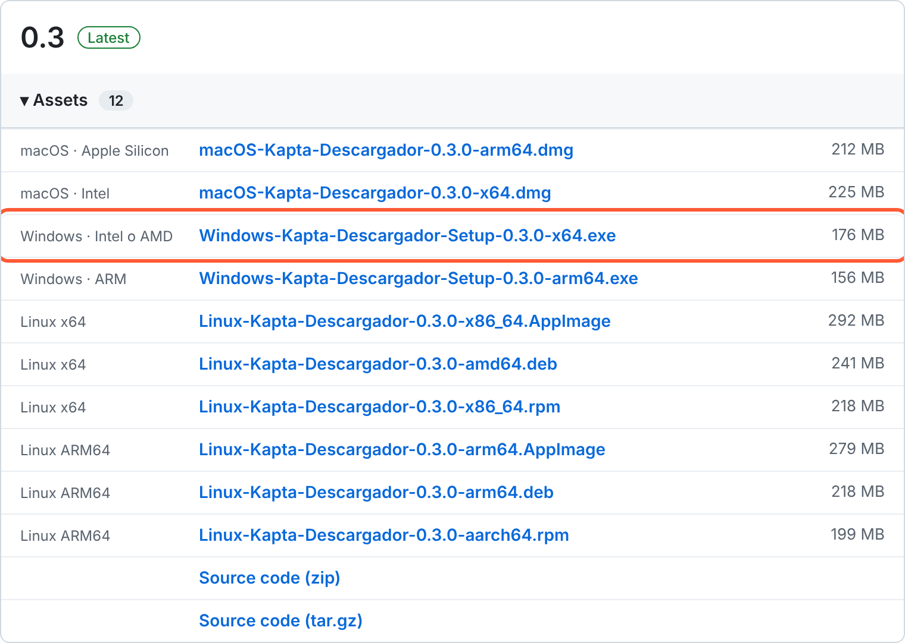</p>
<p align="center"><sub>Ilustración: la sección <b>Assets</b> del release. Ignora <i>Source code</i>: es el código, no la app.</sub></p>

> ¿No sabes qué arquitectura tienes?
> - **Windows:** *Configuración → Sistema → Información*, en *Tipo de sistema*: "procesador basado en x64" → `x64`; "procesador basado en ARM" → `arm64`.
> - **Mac:** menú Apple → *Acerca de esta Mac*. Si dice **Chip Apple M…** → `arm64`; si dice **Procesador Intel** → `x64`.
> - **Linux:** en una terminal, `uname -m`. `x86_64` → x64; `aarch64` → ARM64.

### Windows

El instalador es por usuario: **no pide contraseña de administrador**. Como todavía no está firmado digitalmente, Windows muestra un aviso la primera vez.

1. Abre el archivo `Windows-Kapta-Descargador-Setup-<versión>-x64.exe` (o `-arm64.exe`) desde la carpeta **Descargas** o desde la barra de descargas del navegador.
   - Si el navegador dice que el archivo "no se descarga habitualmente", abre el menú **⋯** de esa descarga y elige **Conservar** (Edge: *Conservar → Mostrar más → Conservar de todos modos*).
2. Aparece **"Windows protegió su PC"**. Haz clic en **Más información**.

   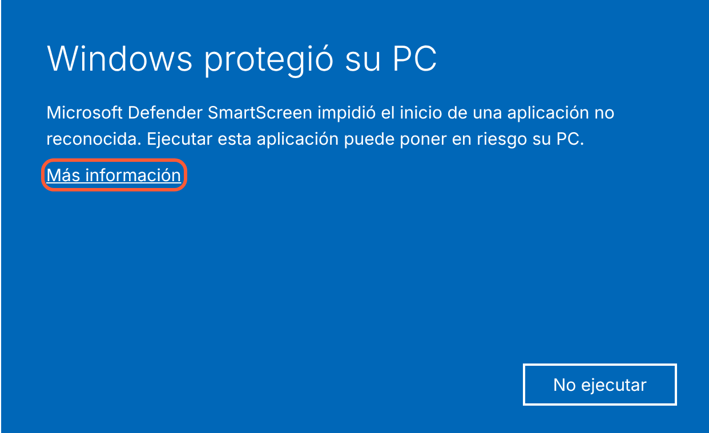

3. Se muestra el nombre del archivo y "Editor desconocido". Haz clic en **Ejecutar de todas formas**.

   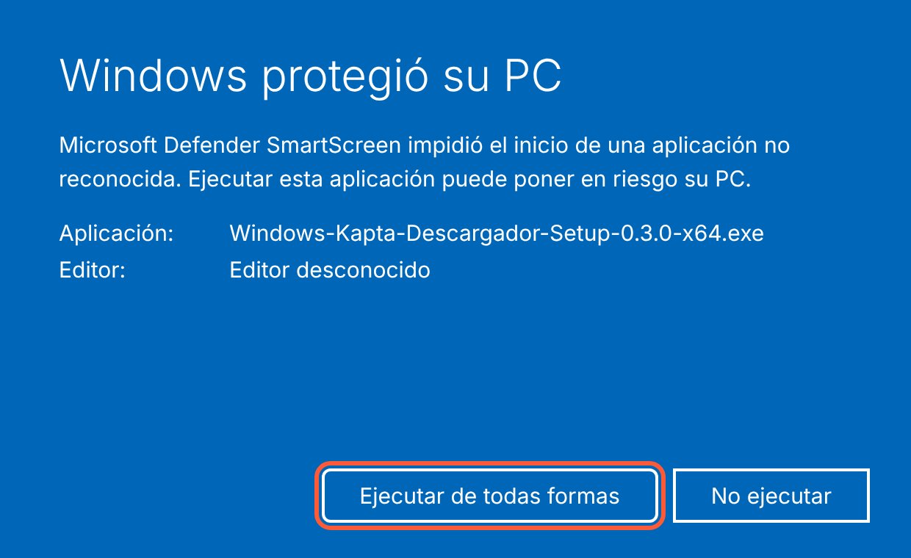

4. Si el asistente pregunta para quién instalarlo, elige **Sólo para mí** y pulsa **Siguiente**.
5. En **Elegir lugar de instalación** deja la carpeta propuesta (o pulsa *Examinar…* para cambiarla) y haz clic en **Instalar**.

   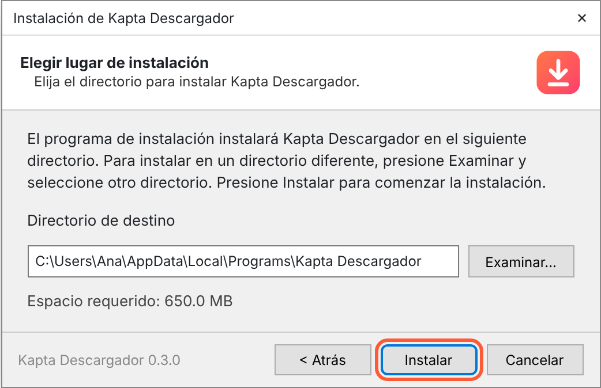

6. Al terminar, deja marcada **Ejecutar Kapta Descargador** y haz clic en **Terminar**.

   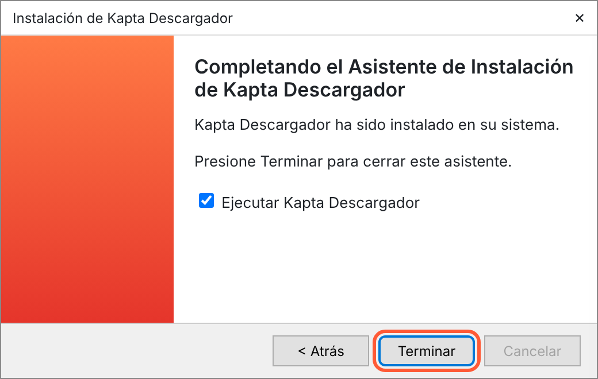

Listo: la app queda en el **Menú Inicio** y con un acceso directo en el **escritorio**.

- **Actualizar:** descarga el instalador de la versión nueva y repite los pasos; se instala encima y conserva tus ajustes e historial.
- **Desinstalar:** *Configuración → Aplicaciones → Aplicaciones instaladas →* **Kapta Descargador** *→ ⋯ → Desinstalar*. Tus ajustes quedan en `%APPDATA%\Kapta Descargador` por si la vuelves a instalar; bórrala a mano si no los quieres.

### Windows con winget

[winget](https://learn.microsoft.com/windows/package-manager/winget/) es el instalador de apps por línea de comandos que ya trae Windows 10 (1809 o más nuevo) y Windows 11. Instala la misma app que el instalador de arriba, pero **sin el aviso de SmartScreen** y elige solo la versión correcta para tu procesador (x64 o ARM).

> **Disponibilidad:** cada versión nueva se envía al catálogo de winget y Microsoft la revisa antes de publicarla (la primera vez puede tardar varios días). Si `winget search kapta` no muestra nada todavía, usa el [instalador de Windows](#windows) mientras tanto.

1. Abre **Terminal** (o **PowerShell**): clic derecho en el botón Inicio → **Terminal**. No hace falta abrirla como administrador.
2. Instala la app:
   ```powershell
   winget install --id josejesusguzman.KaptaDescargador -e
   ```
   La primera vez que usas winget te pide aceptar los términos de los orígenes: escribe `Y` y pulsa Enter.
3. Cuando diga **Instalado correctamente**, busca **Kapta Descargador** en el Menú Inicio.

Si Windows dice que `winget` no se reconoce como comando, instala o actualiza **Instalador de aplicación** desde la Microsoft Store y abre una terminal nueva.

- **Actualizar:** `winget upgrade --id josejesusguzman.KaptaDescargador -e` (o `winget upgrade --all` para actualizar todas tus apps).
- **Desinstalar:** `winget uninstall --id josejesusguzman.KaptaDescargador -e`.
- **Ver la versión disponible:** `winget show --id josejesusguzman.KaptaDescargador -e`.

### macOS

La app no está notarizada por Apple, así que macOS la bloquea la primera vez que la abres. Solo hay que permitirla una vez.

1. Abre el archivo `macOS-Kapta-Descargador-<versión>-arm64.dmg` (o `-x64.dmg`) desde **Descargas**. Se abre una ventana con la app y la carpeta *Applications*.
2. **Arrastra el ícono de Kapta Descargador sobre la carpeta Applications** y espera a que termine de copiarse.

   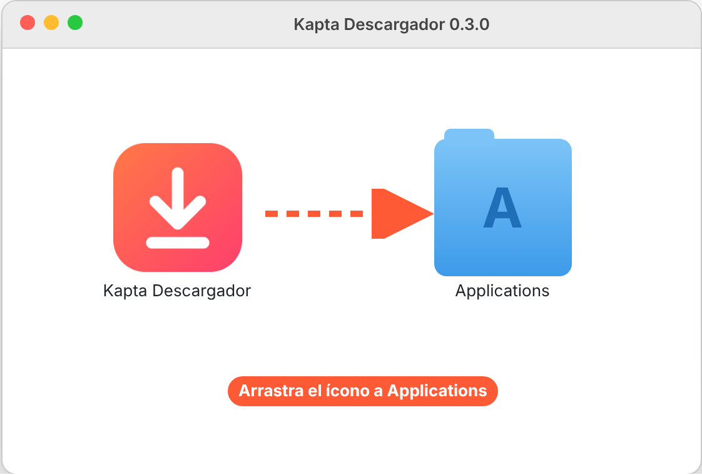

3. Expulsa el disco "Kapta Descargador" (botón ⏏ en la barra lateral del Finder) y abre **Aplicaciones → Kapta Descargador**.
4. Aparece **"No se abrió “Kapta Descargador”"**. Pulsa **Listo** (no la mandes a la papelera).

   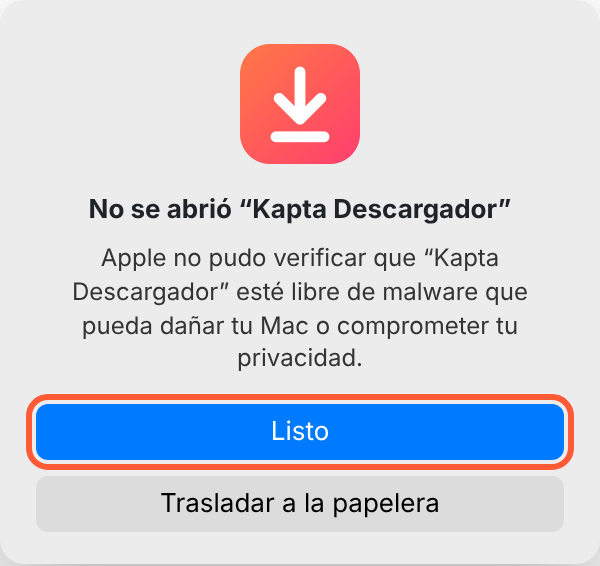

5. Abre el menú Apple → **Ajustes del Sistema → Privacidad y seguridad**, baja hasta **Seguridad** y haz clic en **Abrir de todos modos** junto a "Se bloqueó “Kapta Descargador”…". El botón aparece durante una hora después del intento del paso 4.

   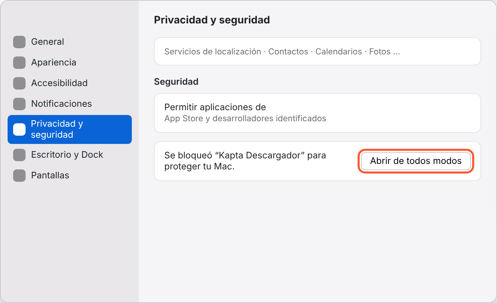

6. Confirma con **Abrir de todos modos** y escribe tu contraseña (o usa Touch ID).

   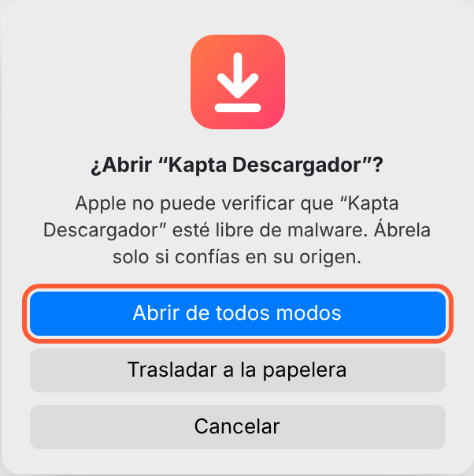

Desde ahí la app se abre normal, con doble clic o desde Launchpad/Spotlight.

- **En macOS 13 y 14** también puedes, en lugar de los pasos 4–6, hacer **clic derecho (o Control + clic) sobre la app en Aplicaciones → Abrir → Abrir**.
- **Alternativa por Terminal** (cualquier versión): copia la app a Aplicaciones y ejecuta
  ```bash
  xattr -dr com.apple.quarantine "/Applications/Kapta Descargador.app"
  ```
  Después ábrela normal; macOS ya no mostrará el aviso.
- La primera vez macOS te puede pedir permiso para **notificaciones** y, si en *Ajustes* eliges usar las cookies de Chrome o Edge, acceso al **Llavero**.
- **Actualizar:** descarga el DMG nuevo y arrastra la app a Applications; elige **Reemplazar**. Puede que tengas que repetir los pasos 4–6.
- **Desinstalar:** arrastra **Kapta Descargador** de Aplicaciones a la Papelera. Tus ajustes quedan en `~/Library/Application Support/Kapta Descargador`.

### Linux: AppImage (cualquier distribución)

Un solo archivo que se ejecuta sin instalar nada.

1. Descarga `Linux-Kapta-Descargador-<versión>-x86_64.AppImage` (o `-arm64.AppImage`).
2. Dale permiso de ejecución, de una de estas dos formas:
   - **Con el gestor de archivos:** clic derecho sobre el archivo → **Propiedades** → activa **Ejecutable como programa** (en algunas distros: pestaña *Permisos → Permitir ejecutar el archivo como un programa*).

     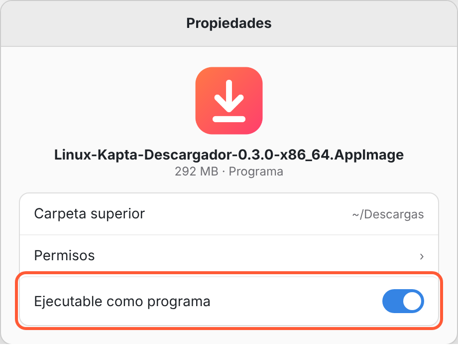

   - **Con la terminal:**
     ```bash
     cd ~/Descargas
     chmod +x Linux-Kapta-Descargador-*.AppImage
     ```
3. Ábrelo con doble clic o con `./Linux-Kapta-Descargador-*.AppImage`.
4. Si no abre y la terminal menciona **FUSE** o `libfuse.so.2`, instala FUSE 2 y vuelve a intentarlo:
   ```bash
   sudo apt install libfuse2t64   # Ubuntu 24.04 o más nuevo
   sudo apt install libfuse2      # Ubuntu 22.04, Debian 12, Mint 21
   sudo dnf install fuse-libs     # Fedora
   ```

- **Actualizar:** descarga el AppImage nuevo y borra el anterior.
- **Desinstalar:** borra el archivo `.AppImage`. Tus ajustes quedan en `~/.config/Kapta Descargador`.

### Linux: paquete .deb (Ubuntu, Debian, Mint)

Instala la app en `/opt/Kapta Descargador` y la agrega al menú de aplicaciones.

1. Descarga `Linux-Kapta-Descargador-<versión>-amd64.deb` (o `-arm64.deb`).
2. Abre una terminal en la carpeta de descargas e instálalo (te pide tu contraseña):
   ```bash
   cd ~/Descargas
   sudo apt install ./Linux-Kapta-Descargador-*-amd64.deb
   ```
   El `./` es necesario para que `apt` use el archivo local e instale las dependencias que falten.
3. Busca **Kapta Descargador** en el menú de aplicaciones, o ejecuta `kapta-descargador` en la terminal.

- **Actualizar:** repite el paso 2 con el `.deb` nuevo.
- **Desinstalar:** `sudo apt remove kapta-descargador`.

### Linux: paquete .rpm (Fedora, openSUSE)

1. Descarga `Linux-Kapta-Descargador-<versión>-x86_64.rpm` (o `-aarch64.rpm`).
2. Instálalo desde la terminal:
   ```bash
   cd ~/Descargas
   sudo dnf install ./Linux-Kapta-Descargador-*.rpm                          # Fedora, RHEL
   sudo zypper install --allow-unsigned-rpm ./Linux-Kapta-Descargador-*.rpm  # openSUSE
   ```
3. Búscala en el menú de aplicaciones o ejecuta `kapta-descargador`.

- **Actualizar:** repite el paso 2 con el `.rpm` nuevo.
- **Desinstalar:** `sudo dnf remove kapta-descargador` o `sudo zypper remove kapta-descargador`.

### Primer uso

Al abrir la app por primera vez verás la bienvenida; pulsa **Empezar**.

<p align="center">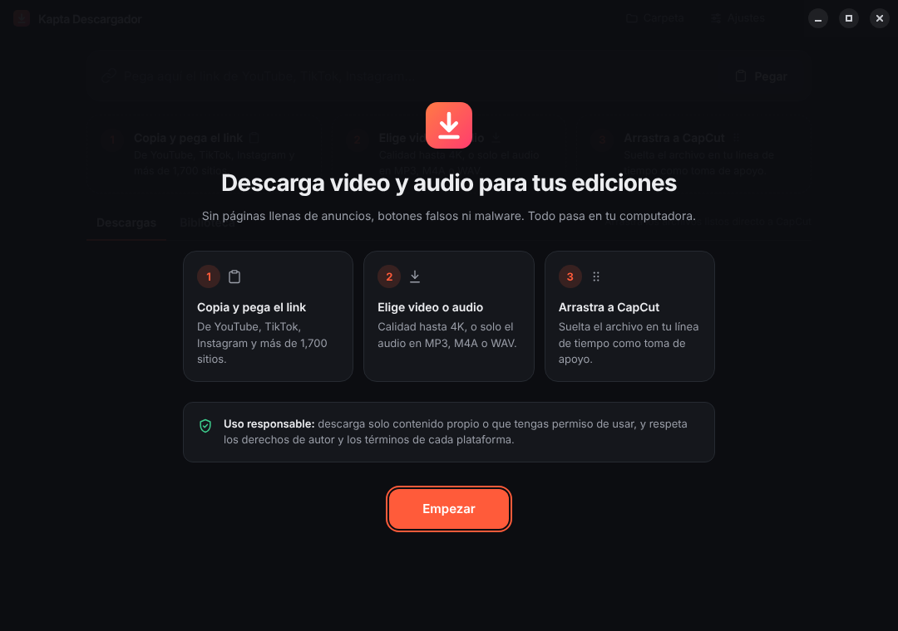</p>

Después, pega el link del video (botón **Pegar** o Ctrl/⌘ + V), elige video o audio y la calidad, y descarga. Los archivos se guardan en la carpeta **Videos → Kapta Descargador** (se cambia en **Ajustes**) y desde la lista los puedes arrastrar directo a CapCut o a tu editor.

<p align="center">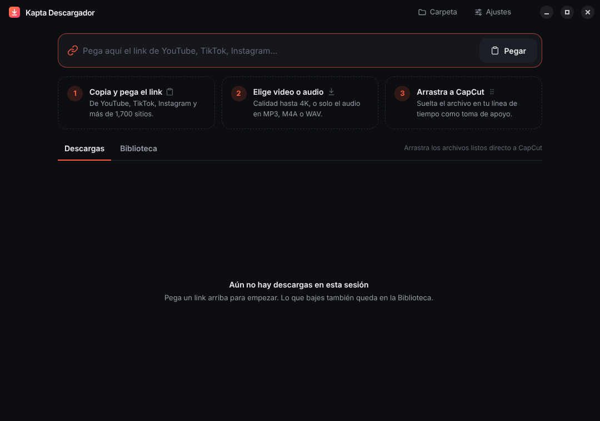</p>

### Desde el código fuente

Para desarrolladores o para equipos sin instalador. Necesitas [Git](https://git-scm.com/) y [Node.js 22](https://nodejs.org/).

```bash
git clone https://github.com/josejesusguzman/Kapta-descargador-videos.git
cd Kapta-descargador-videos
npm install
npm run fetch-binaries   # descarga yt-dlp y FFmpeg para tu sistema
npm run dev              # abre la app en modo desarrollo
```

Para generar tu propio instalador usa `npm run build:win`, `npm run build:mac` (solo en una Mac) o `npm run build:linux` (solo en Linux); el resultado queda en `dist/`. Ver [Desarrollo](#desarrollo).

## Cómo funciona

- **Electron + React** (electron-vite, Tailwind 4, TypeScript).
- **yt-dlp** hace las descargas; **FFmpeg** une pistas, extrae audio y recodifica.
- yt-dlp necesita un runtime de JavaScript para YouTube: se usa el propio ejecutable de la app en modo Node (`ELECTRON_RUN_AS_NODE`), así que no hace falta Deno.
- **Compatible con editores**: si el video llega en VP9/AV1 (YouTube en 2K/4K), se convierte a H.264. Se usa el encoder de GPU disponible (Windows: NVIDIA, Intel, AMD o Media Foundation/Qualcomm; macOS: VideoToolbox; Linux: NVIDIA o VA-API para Intel/AMD) y, si no hay ninguno, la CPU.
- yt-dlp se copia a la carpeta de datos de la app (`%APPDATA%\Kapta Descargador\engine` en Windows, `~/Library/Application Support/Kapta Descargador/engine` en macOS, `~/.config/Kapta Descargador/engine` en Linux) para poder actualizarlo (`yt-dlp -U`) sin permisos de administrador.

### Cambio de nombre (antes "Descargador")

Desde la versión 0.3 la app se llama **Kapta Descargador** y su identificador es `com.kapta.descargador` (antes `com.descargador.app`):

- Al abrirla por primera vez copia los ajustes y el historial de la carpeta de datos anterior (`Descargador`) a la nueva (`Kapta Descargador`). La carpeta anterior no se toca.
- En Windows se instala como una app nueva: desinstala "Descargador" desde *Configuración → Aplicaciones*.
- En macOS borra `Descargador.app` de Aplicaciones y vuelve a permitir las notificaciones y *Abrir al iniciar sesión*.
- En Linux, el .deb y el .rpm instalan un paquete nuevo (`kapta-descargador`): desinstala el anterior con `sudo apt remove descargador` o `sudo dnf remove descargador`.

## Desarrollo

```bash
npm install
npm run fetch-binaries   # yt-dlp + FFmpeg para el sistema y la arquitectura de este equipo, con verificación SHA-256
npm run dev
```

Otros comandos:

| Comando | Qué hace |
|---|---|
| `npm test` | Pruebas unitarias (parser de progreso, argumentos de yt-dlp, errores) |
| `npm run typecheck` | TypeScript en main/preload y renderer |
| `npm run icons` | Regenera `build/icon.ico`, `build/icon.png` (macOS) y los PNG de `resources/icons` (incluido el ícono de la barra de menú de macOS) |
| `npm run build:win` | Instalador x64 → `dist/Windows-Kapta-Descargador-Setup-<versión>-x64.exe` |
| `npm run build:win:arm64` | Instalador para Windows en ARM |
| `npm run build:mac` | DMG para Apple Silicon e Intel → `dist/macOS-Kapta-Descargador-<versión>-{arm64,x64}.dmg` (solo en una Mac) |
| `npm run build:mac:arm64` / `build:mac:x64` | DMG de una sola arquitectura |
| `npm run build:linux` | AppImage, .deb y .rpm x64 → `dist/` (solo en Linux; el .rpm necesita `rpmbuild`, paquete `rpm`) |
| `npm run build:linux:arm64` | Los mismos paquetes para Linux ARM64 |

Los binarios quedan en `resources/bin/<win|mac|linux>-<arch>/` (antes `resources/bin/<arch>/`: si ya tenías un entorno de desarrollo, vuelve a ejecutar `npm run fetch-binaries`).

## Distribución

### Releases automáticos en cada PR a `main`

El workflow **PR a main** (`.github/workflows/pr-release.yml`) corre al abrir un pull request hacia `main` y en cada push posterior a ese PR:

1. Toma el siguiente número de tag respecto al más alto que exista (`0.1` → `0.2` → … → `0.9` → `0.10`) y lo reserva para el PR. Cada PR tiene un solo número.
2. Ejecuta los tres builds (**Build macOS**, **Build Windows** y **Build Linux**) sobre el último commit del PR, con ese número como versión de la app (`0.2` → `0.2.0`).
3. Publica el release con ese tag y le adjunta los 10 instaladores sueltos, sin zip: DMG de macOS (Apple Silicon e Intel), instaladores de Windows (x64 y ARM64) y AppImage, .deb y .rpm de Linux (x64 y ARM64).

   Cada instalador empieza con el sistema al que va dirigido y termina con la arquitectura, por ejemplo `macOS-Kapta-Descargador-0.3.0-arm64.dmg`, `Windows-Kapta-Descargador-Setup-0.3.0-x64.exe` o `Linux-Kapta-Descargador-0.3.0-x86_64.AppImage`.

Un push nuevo al mismo PR vuelve a compilar, reemplaza los instaladores de ese release y mueve el tag al último commit. Si algún build falla, el número queda reservado (como borrador) y se publica cuando el PR vuelva a compilar bien. Los PR desde forks solo compilan: no reciben tag ni release. "Latest" queda siempre en el número más alto, aunque se actualice un PR anterior, y volver a ejecutar una corrida vieja no regresa el release a un commit anterior.

Si GitHub rechaza crear o mover el tag con el token del workflow (puede pasar en PRs que modifican `.github/workflows`), crea un token fine-grained solo para este repo con *Contents* y *Workflows* en *Read and write* y guárdalo como secret `RELEASE_TOKEN`. Mantén desactivado *Immutable releases* (Settings → General → Releases): con él activo, un release publicado ya no acepta instaladores nuevos.

Los tres workflows de build también se pueden lanzar a mano (pestaña *Actions* → *Run workflow*); así dejan los instaladores como artefactos de la ejecución, sin release.

### Windows

El instalador es NSIS por usuario: no pide permisos de administrador y crea accesos en el Menú Inicio y en el escritorio. Sin una PC con Windows, usa el workflow **Build Windows** de GitHub Actions (pestaña *Actions* → *Build Windows* → *Run workflow*): genera en `windows-latest` un artefacto por arquitectura (`Kapta-Descargador-Windows-x64` y `Kapta-Descargador-Windows-arm64`). **No está firmado**, así que Windows SmartScreen mostrará un aviso. Para distribuirlo públicamente conviene firmarlo (Azure Trusted Signing o un certificado OV) configurando `win.signtoolOptions` / `azureSignOptions` en `electron-builder.yml`.

**winget**: al hacer merge de un PR a main, el workflow **Winget** envía los instaladores de Windows de su release a [winget-pkgs](https://github.com/microsoft/winget-pkgs) como `josejesusguzman.KaptaDescargador` (también se puede correr a mano desde *Actions* con el tag de un release). Necesita un token clásico de GitHub con el scope `public_repo` guardado como secret `WINGET_TOKEN`; con él abre un PR en `microsoft/winget-pkgs` desde un fork en tu cuenta, y los revisores de Microsoft lo validan antes de que la versión aparezca en `winget`. Ver [Windows con winget](#windows-con-winget) para las instrucciones de usuario.

### macOS

- Un DMG por arquitectura (Apple Silicon e Intel), compatible desde **macOS 13** (Ventura, el mínimo de Electron 44); se arrastra la app a Aplicaciones.
- **Barra de menú** (solo macOS): un ícono arriba a la derecha muestra el progreso de las descargas. Su menú permite:
  - Descargar el link copiado como video o solo audio, con la calidad y el formato predeterminados, sin abrir la ventana; o abrirlo en la ventana para elegir calidad.
  - Ver las descargas en curso, cancelarlas o reintentar las que fallaron.
  - Abrir las últimas descargas, mostrarlas en el Finder o compartirlas (AirDrop, Mensajes…).
  - Abrir la carpeta de descargas, los ajustes y activar *Abrir al iniciar sesión* (arranca solo en la barra de menú; la app tiene que estar en Aplicaciones).

  Al cerrar la ventana, la app sigue en la barra de menú (sin ícono en el Dock) y las descargas continúan; ⌘Q o *Salir de Kapta Descargador* la cierran. Se desactiva en *Ajustes → Barra de menú*, y entonces cerrar la ventana vuelve a cerrar la app.
- El DMG solo se puede generar en una Mac. Sin una, usa el workflow **Build macOS** de GitHub Actions (pestaña *Actions* → *Build macOS* → *Run workflow*): compila en `macos-latest` y deja cada DMG como un artefacto propio (`Kapta-Descargador-macOS-arm64` para Apple Silicon, `Kapta-Descargador-macOS-x64` para Intel).
- **No está notarizado** (firma ad-hoc). La primera vez macOS bloqueará la app: ábrela, luego ve a *Ajustes del Sistema → Privacidad y seguridad* y pulsa **Abrir de todos modos**. Para distribuirla sin ese aviso hace falta una cuenta de Apple Developer: quita `mac.identity` y pon `mac.notarize: true` en `electron-builder.yml`, y define `CSC_LINK`, `CSC_KEY_PASSWORD`, `APPLE_ID`, `APPLE_APP_SPECIFIC_PASSWORD` y `APPLE_TEAM_ID` (como secrets en el workflow).
- Las cookies de Chrome/Edge se leen del Llavero: macOS pedirá permiso la primera vez.

### Linux

- Tres formatos por arquitectura (x64 y ARM64):
  - **AppImage** (cualquier distro): `chmod +x Linux-Kapta-Descargador-*.AppImage` y ábrelo. Necesita FUSE 2 (`sudo apt install libfuse2t64` en Ubuntu 24.04, `libfuse2` en versiones anteriores).
  - **.deb** (Debian, Ubuntu, Mint…): `sudo apt install ./Linux-Kapta-Descargador-*.deb`.
  - **.rpm** (Fedora, openSUSE…): `sudo dnf install ./Linux-Kapta-Descargador-*.rpm`.
- El .deb y el .rpm instalan la app en `/opt/Kapta Descargador` con su acceso en el menú; el .deb incluye el perfil de AppArmor que Ubuntu 24.04+ pide para el sandbox de Chromium. El AppImage arranca con `--no-sandbox` solo si el sistema no permite user namespaces.
- Sin un equipo con Linux, usa el workflow **Build Linux** de GitHub Actions (pestaña *Actions* → *Build Linux* → *Run workflow*): compila de forma nativa en `ubuntu-latest` (x64) y `ubuntu-24.04-arm` (ARM64) y deja cada paquete como un artefacto propio (`Kapta-Descargador-Linux-<arch>-AppImage`, `-deb` y `-rpm`).

FFmpeg se incluye en su compilación GPL; ver `THIRD_PARTY_NOTICES.md`.

## Licencia

El código de Kapta Descargador se distribuye bajo la licencia MIT (ver `LICENSE`). Los componentes de terceros que incluyen los instaladores (yt-dlp, FFmpeg, Electron, React) conservan sus propias licencias; ver `THIRD_PARTY_NOTICES.md`.

## Estructura

```
src/main/        proceso principal: yt-dlp, FFmpeg, cola, historial, IPC
src/preload/     API segura expuesta al renderer (window.api)
src/renderer/    interfaz React
src/shared/      tipos compartidos
scripts/         descarga de binarios e íconos
```
